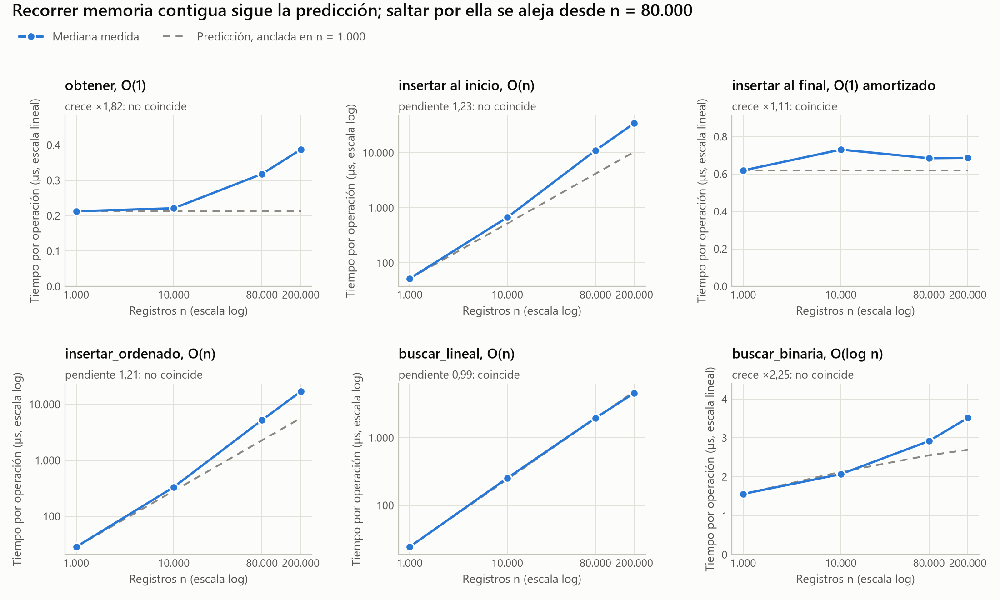
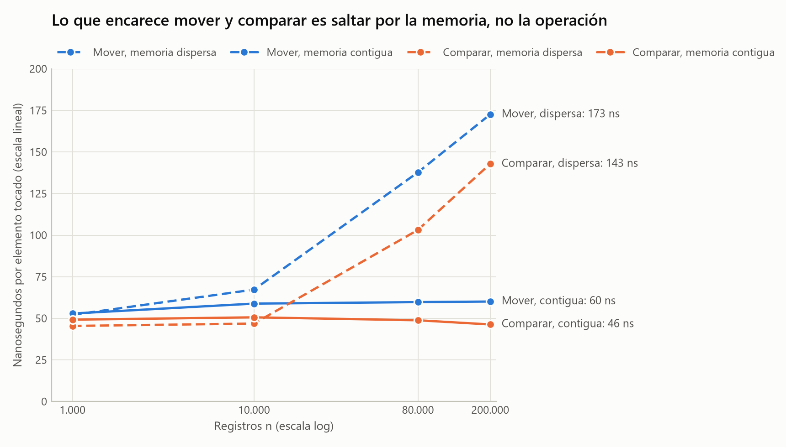

# Comparación con la predicción (Parte C)

Las mediciones salen de `medicion.py` y están completas en `resultados.csv`. Las
cuentas de esta página salen de `analisis.py` (`salida_analisis.txt`).

**Entorno:** AMD Ryzen 3 4300U (caché L2 de 2 MB y L3 de 4 MB en total),
Python 3.12.10, Windows 11, portátil con batería y plan de energía Equilibrado.
Cada tiempo es la mediana de 11 repeticiones. Los tiempos absolutos valen para
esta máquina; lo que se puede trasladar a otra son las proporciones.

## Resultado: tres coinciden, cuatro no

Mediana por operación, en microsegundos:

| Operación | 1.000 | 10.000 | 80.000 | 200.000 |
|---|---:|---:|---:|---:|
| `obtener` | 0,213 | 0,221 | 0,318 | 0,387 |
| `insertar` al inicio | 52,078 | 672,564 | 11.021,537 | 34.515,940 |
| `insertar` al final | 0,620 | 0,731 | 0,685 | 0,687 |
| `insertar_ordenado` | 28,456 | 332,646 | 5.231,178 | 16.992,376 |
| `buscar_lineal` | 24,274 | 253,140 | 1.963,462 | 4.613,499 |
| `buscar_lineal`, fallo | 49,176 | 505,930 | 3.905,044 | 9.261,502 |
| `buscar_binaria` | 1,560 | 2,068 | 2,919 | 3,514 |

Contra los criterios fijados en `prediccion.md` antes de medir:

| Operación | Predicción | Medido | Criterio | ¿Coincide? |
|---|---|---|---|---|
| `buscar_lineal` | O(n) | pendiente 0,990 | 0,9 a 1,1 | sí |
| `buscar_lineal`, fallo | O(n) | pendiente 0,989 | 0,9 a 1,1 | sí |
| `insertar` al final | O(1) amortizado | crece ×1,11 | menos de ×1,5 | sí |
| `insertar` al inicio | O(n) | pendiente 1,226 | 0,9 a 1,1 | **no** |
| `insertar_ordenado` | O(n) | pendiente 1,206 | 0,9 a 1,1 | **no** |
| `obtener` | O(1) | crece ×1,82 | menos de ×1,5 | **no** |
| `buscar_binaria` | O(log n) | crece ×2,25 | ×1,4 a ×2,1 | **no** |

Dos detalles finos de la predicción se cumplieron: fallar una búsqueda lineal
cuesta el doble que acertarla (×2,01 con 200.000), e `insertar_ordenado` cuesta
la mitad que insertar al inicio (×0,49 con 200.000).

## Por qué no coinciden: la memoria

Con n = 10.000, las cuatro curvas que fallan todavía están a menos de un 30 % de lo
predicho; con 200.000, `insertar` al inicio ya va ×3,3 por encima. `prediccion.md`
lo anticipaba: el modelo supone que una operación elemental cuesta lo mismo con
cualquier n, y esa suposición es la que se rompe.

Una `list` de Python no guarda los registros, sino punteros a ellos. Cada ISBN
ocupa 64 bytes en otra parte de la memoria, y aunque mover un puntero no necesita
leer el registro, CPython sí visita el objeto para actualizar su contador de
referencias. Entonces el tamaño que importa es el de los registros:

| n | 1.000 | 10.000 | 80.000 | 200.000 |
|---|---:|---:|---:|---:|
| Registros en memoria | 0,06 MB | 0,64 MB | 5,1 MB | 12,8 MB |

Con 10.000 todavía caben en la caché. Con 80.000 ya no caben en los 4 MB de la
L3, y ahí está el quiebre. Pero que el tamaño cuadre no prueba la causa, así que
se midió con controles: **la misma operación sobre la misma n, cambiando solo la
disposición en memoria**.

Nanosegundos por elemento tocado:

| Elemento tocado | Memoria | 1.000 | 10.000 | 80.000 | 200.000 |
|---|---|---:|---:|---:|---:|
| Mover | dispersa | 52,1 | 67,3 | 137,8 | 172,6 |
| Mover | contigua | 52,9 | 58,8 | 59,7 | 60,1 |
| Comparar | dispersa | 45,4 | 46,8 | 103,2 | 142,8 |
| Comparar | contigua | 49,2 | 50,6 | 48,8 | 46,3 |

Con memoria contigua, mover y comparar cuestan lo mismo con cualquier n, como
decía el modelo. Con memoria dispersa, las dos cuestan unas tres veces más a
200.000. La causa queda demostrada: lo que encarece no es la operación, sino saltar
por la memoria.

Con esto, cada discrepancia tiene explicación:

- **`insertar` al inicio e `insertar_ordenado`.** En el catálogo ordenado, el orden
  por ISBN no tiene nada que ver con el orden en que se crearon los registros, así
  que cada movimiento salta. El control `insertar_inicio_contiguo` hace lo mismo
  sobre memoria contigua y da pendiente 1,024, dentro del criterio.
- **`buscar_binaria`.** Era la desviación esperada: cada comparación cae lejos de
  la anterior. Hasta 10.000 crece ×1,33, frente a los ×1,36 predichos; el exceso
  aparece después. Aun así, con 200.000 son solo 3,5 µs.
- **`obtener`.** Esta **no la anticipé**: esperaba ruido, no una tendencia. Es
  plana hasta 10.000 (0,213 a 0,221 µs) y luego sube, porque la posición es al azar
  y toca un registro que suele estar fuera de la caché. O(1) significa que no
  recorre nada, no que tarde lo mismo en cualquier máquina y tamaño.

## Qué cambia en la predicción

La clasificación Big-O no estaba mal: el número de operaciones es el que dice
`prediccion.md`, y las pruebas lo comprueban contándolas. Lo que falló fue
suponer que todas cuestan igual, y eso afecta las dos predicciones sobre el
equilibrio:

| Predicción | Medido | Veredicto |
|---|---|---|
| El equilibrio casi no depende de n | 1,23, 1,32, 2,67 y 3,69 | **Falsa** en este rango: el catálogo ordenado se dispersa y el desordenado no |
| El equilibrio ronda 1 | 1,23 con 1.000; 3,69 con 200.000 | **Solo** con catálogos que caben en caché |

La consecuencia en `decision.md` es directa: el costo de mover con memoria dispersa
entre el de comparar con memoria contigua es 172,6 / 46,3 = 3,7, justo el equilibrio
medido con 200.000.

## Una corrida descartada

La primera corrida (`corrida_descartada.csv`) medía cada tamaño de corrido. Se
descartó por dos síntomas que no tenían sentido: `buscar_binaria` salía más lenta
con 1.000 (2,45 µs) que con 10.000 (2,00 µs), y `buscar_lineal` con 10.000 bajó de
412 a 302 µs a lo largo de sus siete repeticiones. El rendimiento del computador
iba cambiando durante la corrida, y como cada tamaño se medía en un solo bloque, ese
cambio se confundía con el efecto de n. La mediana no corrige una deriva.

Por eso `medicion.py` mide por rondas en orden al azar: la deriva cae pareja sobre
todos los casos. Con n = 1.000 los tiempos bajaron casi a la mitad (entre ×0,53 y
×0,64); con 80.000 y 200.000 cambiaron mucho menos (entre ×0,90 y ×1,06). El
archivo se conserva para que el descarte se pueda revisar.
