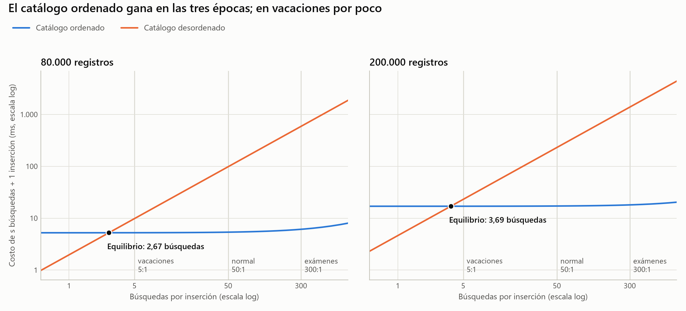

# La decisión: ¿conviene mantener el catálogo ordenado? (Parte D)

**Sí, conviene, y la respuesta no cambia con la época del año.** Con la proporción
habitual de 50 búsquedas por inserción, el catálogo ordenado cuesta 18,3 veces
menos con 80.000 registros y 13,4 veces menos con 200.000. También gana en
vacaciones, aunque por poco: ×1,9 hoy y ×1,4 el año que viene.

La respuesta solo cambiaría por debajo de **2,67 búsquedas por inserción con 80.000
registros, o 3,69 con 200.000**. Ninguna época de la biblioteca llega tan abajo.

Todas las cifras salen de `resultados.csv` mediante `analisis.py`
(`salida_analisis.txt`), medidas en la máquina descrita en `comparacion.md`.

## Costo de 50 búsquedas + 1 inserción

Los dos escenarios son:

- **Ordenado:** cada búsqueda es `buscar_binaria`; cada libro nuevo, `insertar_ordenado`.
- **Desordenado:** cada búsqueda es `buscar_lineal`; cada libro nuevo va al final.

Tiempos medidos que entran en el cálculo (mediana, en µs):

| Operación | 80.000 | 200.000 |
|---|---:|---:|
| `buscar_binaria` | 2,919 | 3,514 |
| `insertar_ordenado` | 5.231,178 | 16.992,376 |
| `buscar_lineal` | 1.963,462 | 4.613,499 |
| `insertar` al final | 0,685 | 0,687 |

Con 80.000 registros:

```
ordenado    = 50 × 2,919     + 5.231,178 =   5.377,1 µs =   5,38 ms
desordenado = 50 × 1.963,462 +     0,685 =  98.173,8 µs =  98,17 ms
```

Con 200.000 registros:

```
ordenado    = 50 × 3,514     + 16.992,376 =  17.168,1 µs =  17,17 ms
desordenado = 50 × 4.613,499 +      0,687 = 230.675,6 µs = 230,68 ms
```

## ¿Cambia según la época?



| Época | Búsquedas por inserción | n | Ordenado (ms) | Desordenado (ms) | Gana | Ventaja |
|---|---:|---:|---:|---:|---|---:|
| Vacaciones | 5 | 80.000 | 5,25 | 9,82 | ordenado | ×1,9 |
| Vacaciones | 5 | 200.000 | 17,01 | 23,07 | ordenado | ×1,4 |
| Normal | 50 | 80.000 | 5,38 | 98,17 | ordenado | ×18,3 |
| Normal | 50 | 200.000 | 17,17 | 230,68 | ordenado | ×13,4 |
| Exámenes | 300 | 80.000 | 6,11 | 589,04 | ordenado | ×96,5 |
| Exámenes | 300 | 200.000 | 18,05 | 1.384,05 | ordenado | ×76,7 |

## Punto de equilibrio

Se igualan los dos costos y se despejan las búsquedas por inserción, `s`:

```
s · binaria + insertar_ordenado = s · lineal + insertar_final

s* = (insertar_ordenado − insertar_final) / (lineal − binaria)
```

| n | Cálculo | s* | Rango por cuartiles |
|---:|---|---:|---|
| 80.000 | (5.231,178 − 0,685) / (1.963,462 − 2,919) | **2,67** | 2,38 a 2,81 |
| 200.000 | (16.992,376 − 0,687) / (4.613,499 − 3,514) | **3,69** | 3,35 a 4,14 |

Por encima de `s*` conviene ordenar; por debajo, no. En otras palabras: insertar un
libro en orden cuesta lo mismo que 2,67 búsquedas lineales hoy y que 3,69 el año
que viene.

## El enunciado avisa que esto debería revisarse

El enunciado dice que en vacaciones la respuesta puede ser la contraria y que, si
sale lo mismo en las tres épocas, hay que revisar el cálculo. Salió lo mismo, así
que se revisó de cuatro maneras:

1. **Las cuentas:** los cálculos de arriba reproducen a mano los del programa, y
   `test_analisis.py` comprueba que en `s*` los dos costos son idénticos.
2. **Otra corrida:** la corrida descartada, con otro diseño y otro momento de la
   máquina, da 2,57 y 3,25. Misma conclusión.
3. **El ruido:** ni el cuartil más desfavorable llega a 5: el máximo es 4,14.
4. **La causa física:** `s*` debería ser el costo de mover entre el de comparar, y
   con 200.000 eso da 172,6 / 46,3 = 3,7 (`comparacion.md`). Medidos por separado,
   coinciden.

**El resultado no es un error de cálculo.** Tiene una explicación simple: insertar
en orden mueve en promedio n/2 registros y una búsqueda lineal compara con n/2.
Son trabajos del mismo tamaño, así que una inserción cuesta unas pocas búsquedas, no
cinco o más.

Lo que sí es cierto es que vacaciones **puede** invertirse si cambian los supuestos:

| Supuesto | s* con 80.000 | s* con 200.000 | ¿Vacaciones (5) cambia? |
|---|---:|---:|---|
| Caso base: la búsqueda acierta y el libro nuevo cae en cualquier parte | 2,67 | 3,69 | no |
| Toda búsqueda falla y recorre el catálogo entero | 1,34 | 1,84 | no |
| Todo libro nuevo cae al inicio (peor caso del ordenado) | **5,62** | **7,49** | **sí** |

También se invertiría si las búsquedas se concentraran al principio de la lista: la
búsqueda lineal tendría que parar, en promedio, antes del 26,7 % del catálogo con
80.000 registros, o del 36,9 % con 200.000, en lugar del 50 %. Las dos condiciones
son posibles, pero ninguna corresponde al caso: nada indica que los libros nuevos
caigan siempre al inicio, y no hay datos de qué se busca.

## Recomendación a la biblioteca

**Mantener el catálogo ordenado todo el año**, sin cambiar de régimen por época.

- **Resuelve el crecimiento.** Hoy un ciclo de 50 búsquedas + 1 inserción cuesta
  98,17 ms. Sin cambiar nada, con 200.000 registros subiría a 230,68 ms (×2,3).
  Ordenando bajaría a 17,17 ms: 5,7 veces menos que hoy, con 2,5 veces más libros.
- **Paga lo que cuesta.** Cada inserción cuesta 5,2 ms hoy y 17 ms con 200.000
  registros. A cambio, cada búsqueda baja de 1.963 a 2,9 µs hoy y de 4.613 a 3,5 µs
  con 200.000.
- **Vacaciones es la época justa, pero no la invierte.** Con 200.000 registros la
  ventaja es de ×1,4. Dejar de ordenar solo en esa época no compensa: se perdería
  esa ventaja y además habría que reordenar todo al volver.
- **La carga inicial se recupera pronto.** Ordenar los 80.000 registros una vez
  requiere unas n · log₂ n = 1,3 millones de comparaciones, lo que ahorran unas 33
  búsquedas. Esta cifra es una estimación por conteo, no una medición.

Conviene volver a medir si la proporción de alguna época baja de 4 búsquedas por
inserción o si el catálogo pasa con claridad de 200.000 registros: `s*` subió de
2,67 a 3,69 al crecer el catálogo, y esta medición no dice dónde se detiene.

## Límites de este análisis

- Los tiempos son de una implementación en Python puro, en un portátil con batería.
  Con otra máquina cambiarán; `s*` depende de la relación entre mover y comparar.
- Se supone que los libros buscados y los nuevos están repartidos al azar por todo
  el catálogo. Si el código del libro fuera consecutivo, los nuevos caerían al final
  y mantener el orden sería casi gratis.
- Las búsquedas de la base siempre aciertan. Una búsqueda real a veces falla, lo que
  favorece al catálogo ordenado.
- Solo se mueven punteros. Si los registros completos se guardaran seguidos (por
  ejemplo, en un archivo), desplazarlos costaría mucho más y `s*` podría superar 5.
  Esto no se midió.
